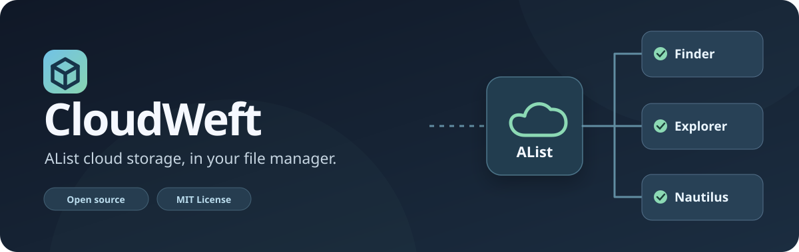
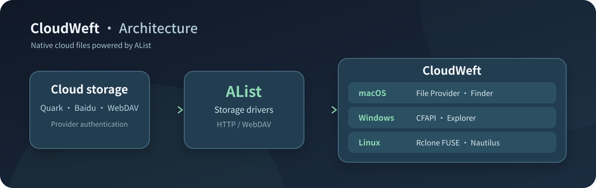
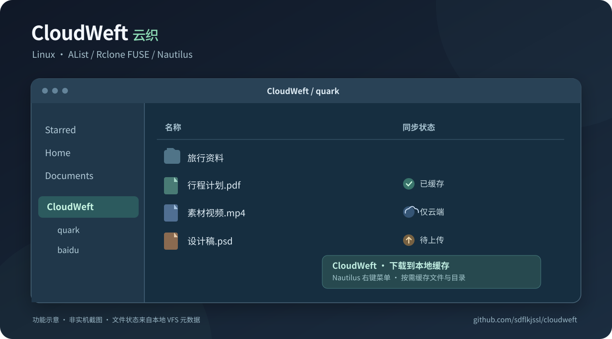

<div align="center">



**Your cloud storage, right in your file manager.**

**CloudWeft is a cross-platform cloud filesystem integration for Windows, macOS and Linux.** Connect AList-backed cloud drives to native file managers for on-demand reads and cloud write-back.

[中文](README.md) · [Windows guide](docs/windows.en.md) · [macOS guide](docs/macos.md) · [Linux guide](docs/linux.md)

</div>

## How it works



AList provides storage drivers, authentication and WebDAV; CloudWeft integrates these drives using each operating system's filesystem framework. All three platforms support directory browsing, on-demand file access and local modifications written back to the cloud.

## Platform support

| Platform | File manager | Filesystem integration | Documentation |
|---|---|---|---|
| Windows | Explorer | Cloud Files API (CFAPI) | [Windows](docs/windows.en.md) |
| macOS | Finder | Apple File Provider | [macOS](docs/macos.md) |
| Linux | Nautilus | Rclone FUSE/VFS + Nautilus extension | [Linux](docs/linux.md) |

## Linux desktop preview



<sub>Feature illustration, not an actual Nautilus screenshot.</sub>

The Nautilus extension shows online-only, cached and pending-upload status, with a **Download to local cache** context menu. Each AList storage is mounted in its own directory under `~/CloudWeft`.

## Installation

**Windows:** Run `powershell -ExecutionPolicy Bypass -File .\windows\install.ps1` and configure the storage with AList. See the [Windows guide](docs/windows.en.md).

**macOS:** Run `bash scripts/install-macos.sh`. See the [macOS guide](docs/macos.md).

**Ubuntu / GNOME:**

```bash
git clone https://github.com/sdflkjssl/cloudweft.git
cd cloudweft
bash linux/install.sh
```

The Linux installer checks dependencies, configures AList and user-level systemd services, and adds the Nautilus integration. Add a provider at the [local AList administration page](http://127.0.0.1:5244/@manage/storages); the administrator password is stored at `~/.local/share/cloudweft/alist-admin-pass.txt`, readable by the current user only. Services bind to localhost.

## Validation and support

Linux unit tests: `python3 -m unittest discover -s linux/tests -p 'test_*.py'`. Isolated FUSE integration test: `python3 linux/tests/integration.py`. The integration test restarts the user mount service; run it when there are no pending writes. See [GitHub Issues](https://github.com/sdflkjssl/cloudweft/issues).

## License and attribution

CloudWeft is MIT-licensed. The macOS File Provider implementation includes MIT-licensed code from [plinth](https://github.com/ytomasch/plinth). AList, Rclone and Wusel retain their respective licenses; see [third-party notices](docs/third-party-notices.en.md). Windows sync-root identities and macOS File Provider identifiers are preserved for installation compatibility.

## Friendly Links

[Community](https://linux.do/)
