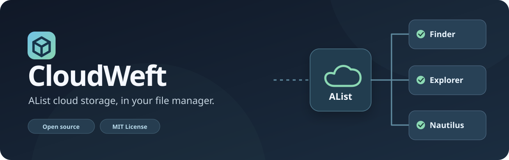
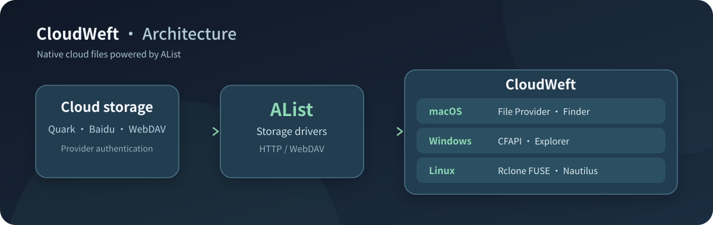
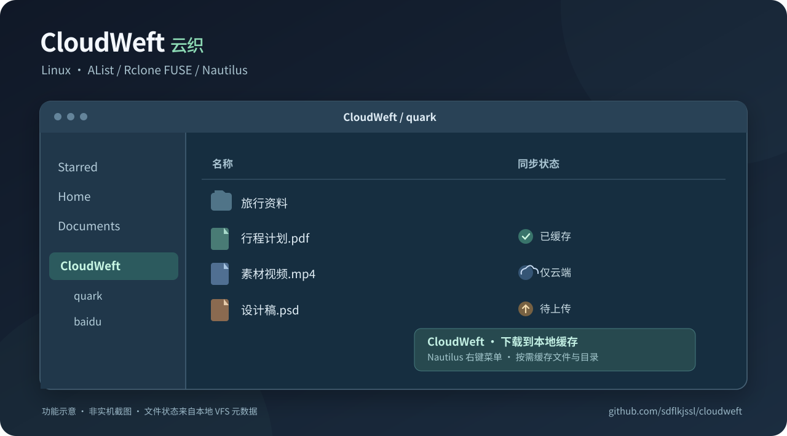

<div align="center">



**云盘，在文件管理器里。**

**CloudWeft 是跨平台开源云文件管理工具，完整覆盖 Windows、macOS 和 Linux。** 通过 AList 将夸克、百度等网盘直接接入系统原生文件管理器，支持按需读取文件并将本地修改写回云端。

[English](README.en.md) · [Windows 安装](docs/windows.md) · [macOS 安装](docs/macos.md) · [Linux 安装](docs/linux.md) · [Linux Do 发布文案](docs/LINUX_DO_BETA.md)

</div>

## 工作原理



AList 统一管理云盘驱动、账号认证和 WebDAV 访问；CloudWeft 在不同操作系统中使用相应的原生文件系统机制，实现文件浏览、按需下载、修改写回及同步状态展示。

## 平台支持

| 平台 | 文件管理器 | 文件系统集成 | 使用说明 |
|---|---|---|---|
| Windows | Explorer | Cloud Files API（CFAPI） | [Windows 指南](docs/windows.md) |
| macOS | Finder | Apple File Provider | [macOS 指南](docs/macos.md) |
| Linux | Nautilus | Rclone FUSE/VFS + Nautilus 扩展 | [Linux 指南](docs/linux.md) |

三个平台共享 AList 网盘驱动。文件在打开时按需读取，本地保存后写回网盘。Windows 和 macOS 使用系统原生文件提供程序；Linux 通过 Rclone 文件系统挂载及 Nautilus 扩展集成。

## Linux 桌面预览



<sub>功能示意图，非 Nautilus 实机截图。</sub>

Nautilus 扩展展示云端、已缓存和待上传状态，并提供「下载到本地缓存」右键菜单。AList 中的每个存储映射为 `~/CloudWeft` 下的独立目录。

## 安装

**Windows**：在 PowerShell 中执行 `powershell -ExecutionPolicy Bypass -File .\windows\install.ps1`，随后在 AList 配置网盘并通过 `windows/attach-provider.ps1` 挂载。详见 [Windows 指南](docs/windows.md)。

**macOS**：执行 `bash scripts/install-macos.sh`，详见 [macOS 指南](docs/macos.md)。

**Ubuntu / GNOME**：

```bash
git clone https://github.com/sdflkjssl/cloudweft.git
cd cloudweft
bash linux/install.sh
```

Linux 安装脚本自动检查依赖、部署 AList 和用户级 systemd 服务、配置 Nautilus 入口。首次使用在 [本机 AList 管理界面](http://127.0.0.1:5244/@manage/storages) 添加网盘；管理员密码保存在 `~/.local/share/cloudweft/alist-admin-pass.txt`，仅当前用户可读。服务默认只监听本机地址。

## 验证与支持

Linux 单元测试：`python3 -m unittest discover -s linux/tests -p 'test_*.py'`；独立 FUSE 集成测试：`python3 linux/tests/integration.py`。集成测试会短暂重启用户级挂载服务，运行前应确保没有正在写入的文件。技术说明及问题记录见 [GitHub Issues](https://github.com/sdflkjssl/cloudweft/issues) 和各平台指南。

## 许可证与来源

CloudWeft 主体采用 [MIT](LICENSE) 许可证。macOS File Provider 含基于 [plinth](https://github.com/ytomasch/plinth) 的 MIT 代码；AList、Rclone 和 Wusel 等分别遵循其许可证。依赖来源见 [第三方组件声明](docs/third-party-notices.md) 和 [Wusel 图标许可证](linux/nautilus/APACHE-2.0.txt)。为兼容既有安装，Windows 同步根目录与 macOS File Provider 标识保留原值。
