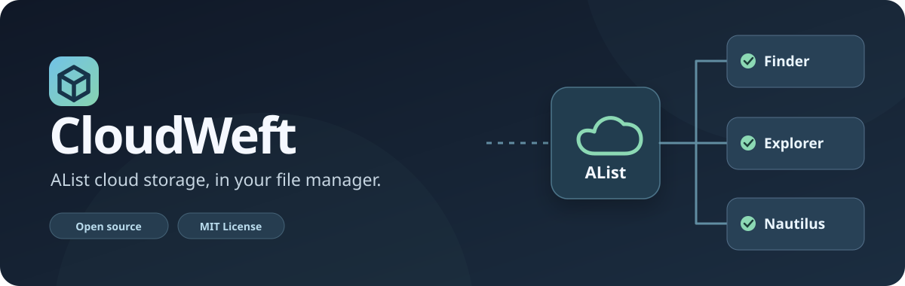
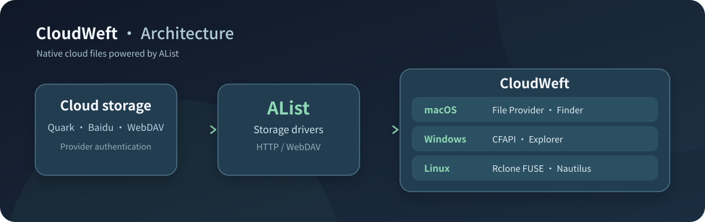
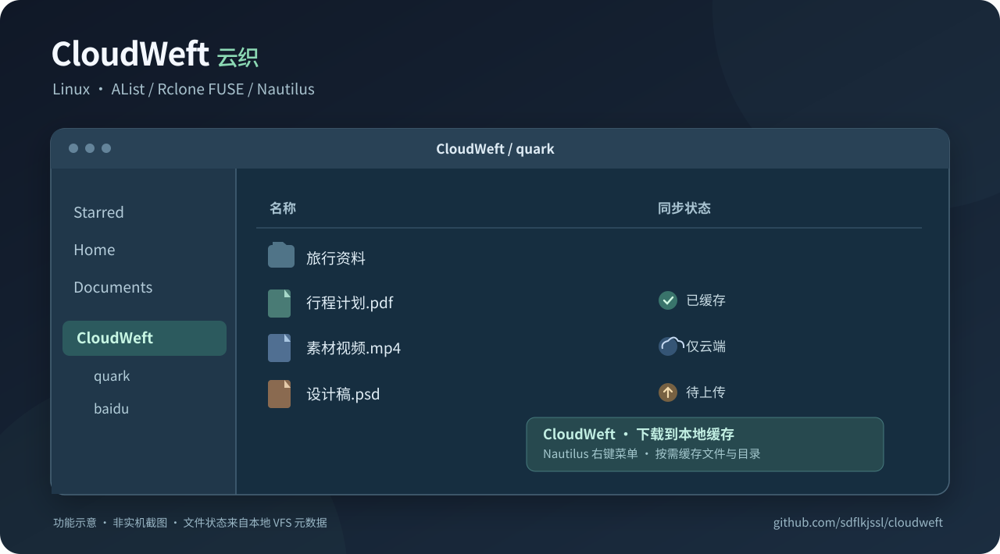

# [开源] CloudWeft 云织：Windows、macOS、Linux 三平台原生网盘文件管理



**CloudWeft（云织）是一款跨平台开源云文件管理工具，同时支持 Windows、macOS 和 Linux。** 通过 AList 接入夸克、百度网盘等服务，将云盘文件直接呈现在 Windows 资源管理器、macOS Finder 和 Linux Nautilus 中。文件可以按需读取、本地修改并写回网盘，支持系统文件管理器中的正常文件操作。

GitHub：**https://github.com/sdflkjssl/cloudweft** ｜ MIT 开源

## 统一架构，三个平台



CloudWeft 使用 AList 作为统一的网盘驱动、认证和 WebDAV 层，各平台则采用对应的文件系统集成机制：

| 系统 | 文件管理器 | 集成方式 |
|---|---|---|
| Windows | 资源管理器 Explorer | Windows Cloud Files API（CFAPI） |
| macOS | Finder | Apple File Provider |
| Linux | Nautilus | Rclone FUSE/VFS + Nautilus 扩展 |

因此云盘可以融入系统现有的文件浏览、打开与保存流程。三个平台共享网盘驱动层，各自通过系统支持的机制呈现文件状态。Windows 和 macOS 的旧版本内部同步标识继续保留，以兼容已有安装。

## Linux 桌面预览



*深色功能示意图，非 Nautilus 实机截图。*

Ubuntu 版本在文件管理器中显示云端、已缓存、待上传状态，提供「下载到本地缓存」右键操作；各 AList 网盘分别挂载到 `~/CloudWeft` 下的目录。Linux 使用 Rclone VFS 实现按需读取与异步写回，用户登录后自动恢复挂载。

## 三平台安装

**Windows**：克隆仓库后，在 PowerShell 中运行 `powershell -ExecutionPolicy Bypass -File .\windows\install.ps1`。完整步骤见 [Windows 指南](https://github.com/sdflkjssl/cloudweft/blob/main/docs/windows.md)。

**macOS**：克隆仓库后执行 `bash scripts/install-macos.sh`。完整步骤见 [macOS 指南](https://github.com/sdflkjssl/cloudweft/blob/main/docs/macos.md)。

**Ubuntu / GNOME**：

```bash
git clone https://github.com/sdflkjssl/cloudweft.git
cd cloudweft
bash linux/install.sh
```

Linux 脚本自动安装所需系统依赖，配置 AList、用户级 systemd 服务和 Nautilus 扩展。在 `http://127.0.0.1:5244/@manage/storages` 添加云盘，用户名为 `admin`，管理员密码位于 `~/.local/share/cloudweft/alist-admin-pass.txt`。文件管理器中打开 `~/CloudWeft` 即可访问。

项目包含中英文 README、三平台安装指南、源代码及许可证。详细说明见 [CloudWeft GitHub 仓库](https://github.com/sdflkjssl/cloudweft)。
